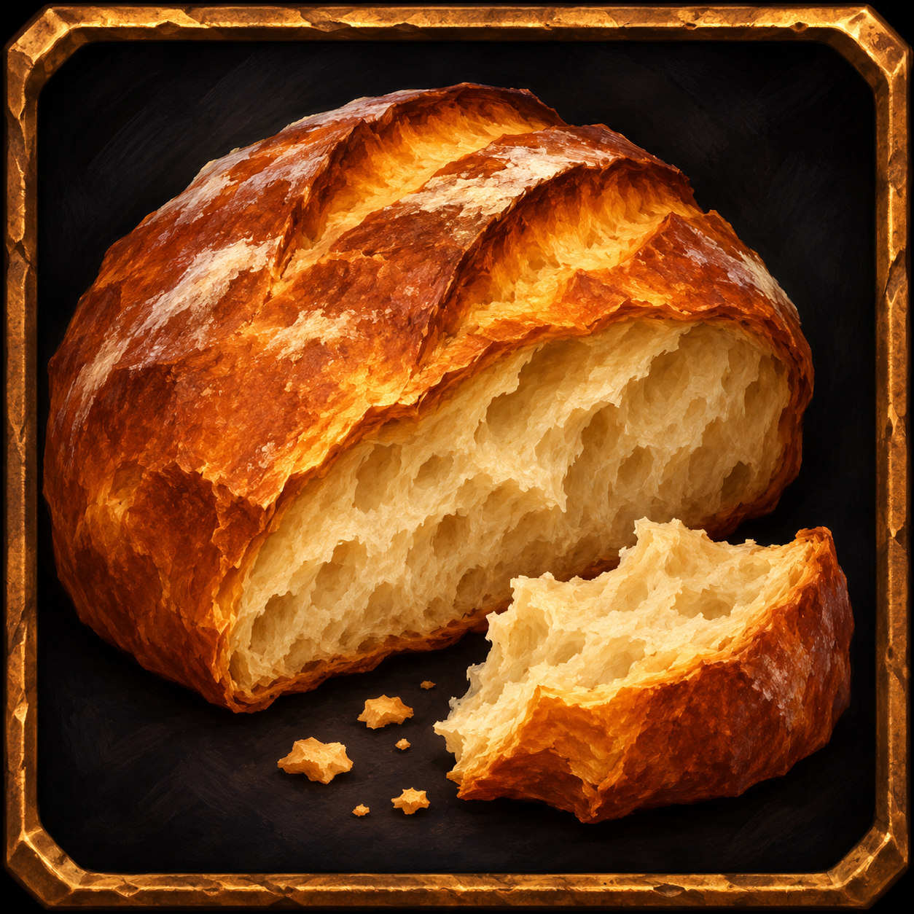
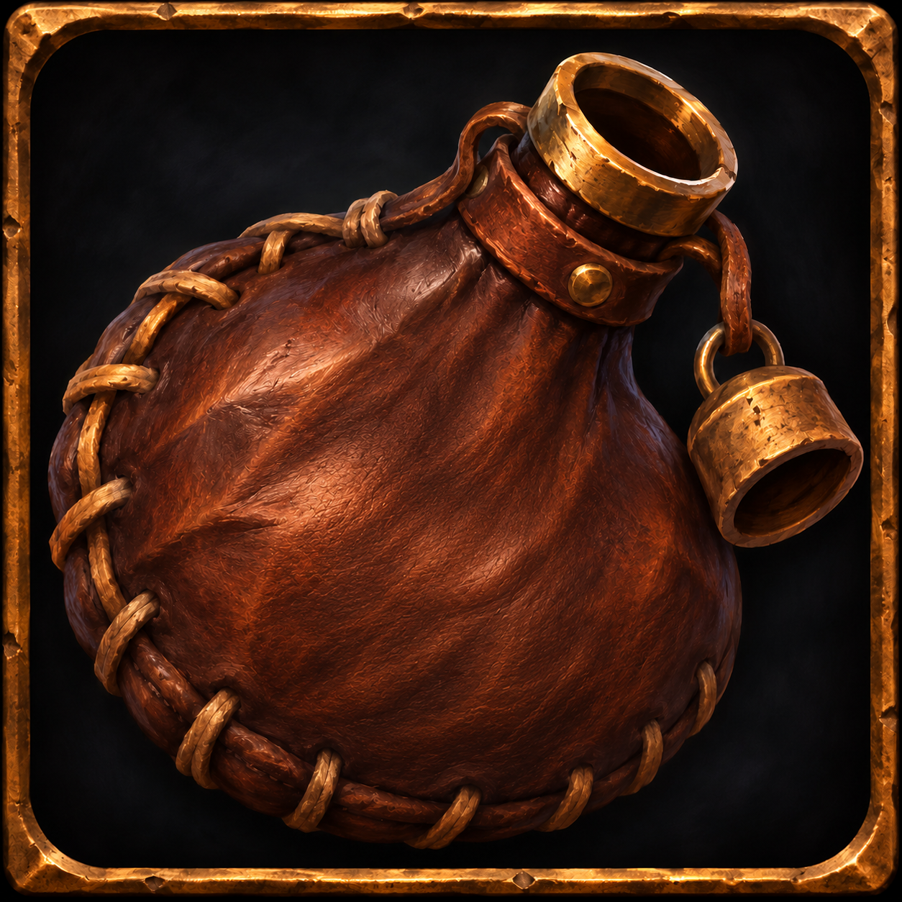
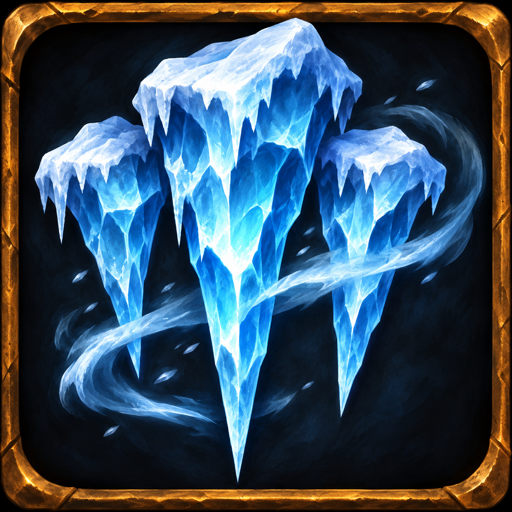

# Sylvania Challenges

Version Sylvania du module de défis pour **AzerothCore / World of Warcraft WotLK 3.3.5a**, issue des sources installées sur notre royaume R1. Le pack comprend **10 défis**, dont nos ajouts **Martyr** et **Survival**.

Cette première publication est une **version de test**. Le code serveur correspond à la version déployée ; le rendu de l'addon et les nouveaux malus Survival restent à valider en jeu.

**[Télécharger le pack complet ZIP — les 10 défis + l'addon](https://github.com/BlaMacfly/Sylvania-Challenges/releases/download/v1.0.0-beta.2/Sylvania-Challenges-v1.0.0-beta.2.zip)** · [Addon Survival seul](https://github.com/BlaMacfly/Sylvania-Challenges/releases/download/v1.0.0-beta.2/SylvaniaSurvival-0.2.0-WotLK-3.3.5a.zip) · [Voir la release](https://github.com/BlaMacfly/Sylvania-Challenges/releases/tag/v1.0.0-beta.2)

## Les 10 défis inclus

| Défi | Fonctionnement |
|---|---|
| **Hardcore** | Une seule vie : la mort est définitive et le personnage ne peut plus être ressuscité. |
| **Semi-Hardcore** | À la mort, perte de l'équipement porté et de l'argent transporté. |
| **Auto-artisanat / Self Crafted** | Équipement fabriqué par le personnage. |
| **Qualité d'objet limitée** | Équipement de qualité grise ou blanche uniquement. |
| **XP lente** | Gain d'expérience multiplié par 0,5 selon la configuration. |
| **XP très lente** | Gain d'expérience multiplié par 0,25 selon la configuration. |
| **XP de quêtes uniquement** | Expérience obtenue uniquement par les quêtes. |
| **Iron Man** | Mort définitive, équipement gris/blanc, restrictions de talents, enchantements, métiers, consommables et groupes. |
| **Martyr** | Chaque mort PvP ou causée par une créature retire 10 % de l'XP nécessaire au niveau suivant. Si l'XP disponible ne suffit pas, le personnage perd un niveau et repart à 80 % de sa nouvelle barre. Le niveau ne descend jamais sous 1. Récompense de 500 Sylvania Coins au niveau 80 selon les règles du serveur. |
| **Survival** | Gestion de la nourriture, de l'hydratation et du froid. Nourriture vide : **−50 % aux cinq caractéristiques principales**. Hydratation vide : la vie descend progressivement jusqu'à **1 %**. Le froid ralentit le personnage ; les abris et feux de cuisine permettent de se réchauffer. |

<p>
  
  
  
</p>

Survival se choisit volontairement au niveau 1 à l'autel des défis, se termine au niveau 80 et ne s'applique qu'aux personnages inscrits. L'addon est un affichage : les réserves et malus sont calculés par le serveur. Les dangers habituels du jeu peuvent toujours tuer le personnage.

Cette version comprend également le canal réservé `Defis`, les annonces et les récompenses propres à Sylvania.

## Téléchargement

Les [Releases](https://github.com/BlaMacfly/Sylvania-Challenges/releases) proposent :

- **[Le pack complet ZIP](https://github.com/BlaMacfly/Sylvania-Challenges/releases/download/v1.0.0-beta.2/Sylvania-Challenges-v1.0.0-beta.2.zip)**, avec les 10 défis, les SQL, la documentation et l'addon Survival prêt à copier.
- **L'addon Sylvania Survival seul**, version 0.2.0 pour le client WotLK 12340.
- Les empreintes SHA-256 des archives.

L'addon affiche **Nourriture / Hydratation / Froid**, les malus réellement confirmés par le serveur et leurs explications au survol. Son cadre est déplaçable ; sa position et sa taille sont conservées par personnage. La commande `/survivalui test` ouvre un aperçu de 60 secondes sans modifier le personnage.

## Installation serveur

Les **10 défis sont regroupés dans deux dossiers de code** : `mod-challenge-modes` contient les huit défis historiques et Martyr ; `mod-survival` ajoute le dixième défi. Placez ces dossiers côte à côte dans les sources du core :

```text
azerothcore/
└── modules/
    ├── mod-challenge-modes/
    └── mod-survival/
```

Les sources de `mod-challenge-modes` incluent déjà Survival. Installez les deux dossiers ensemble ; aucun patch d'intégration supplémentaire n'est nécessaire. Les configurations distribuées et les chargeurs sont ceux exportés du serveur.

Suivez le [guide d'installation](docs/INSTALLATION.md) pour les bases de données, la compilation et la configuration. Les [profils R1](profiles/r1) reproduisent les réglages de jeu de Sylvania ; la configuration Survival distribuée reste désactivée par défaut.

## Sources et validation

Compatibilité de référence : révision AzerothCore `1aea86e8932da61ba500f20f7267fcd4861cd0f5`, utilisée sur Sylvania R1. Les sources et textures installées sont conservées à l'identique ; leurs empreintes figurent dans [SERVER_SNAPSHOT.json](docs/SERVER_SNAPSHOT.json). Les ajouts de publication concernent l'installation, la documentation, les vérifications et la fabrication des archives.

Le moteur Survival et l'addon disposent de **55 contrôles automatisés**. Les sources C++ ont également été compilées avec le core R1. Voir les [vérifications et limites connues](docs/VALIDATION.md).

## Origine et crédits

Basé sur [ZhengPeiRu21/mod-challenge-modes](https://github.com/ZhengPeiRu21/mod-challenge-modes). Le [README d'origine](docs/UPSTREAM_README.md), la licence MIT et les mentions présentes dans les sources sont conservés. Voir [NOTICE.md](NOTICE.md).

## Contributeurs

**[BlaMacfly](https://github.com/BlaMacfly)** — créateur et mainteneur de Sylvania Challenges, conception et adaptations des défis Sylvania, Martyr, Survival, récompenses et intégration au serveur.

**[ZhengPeiRu21](https://github.com/ZhengPeiRu21)** et les contributeurs d'AzerothCore — module historique et infrastructure d'origine. Voir [AUTHORS.md](AUTHORS.md).
